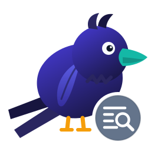

<p align="center">
  
</p>

<h1 align="center">Snodra Event Browser</h1>

<p align="center">
  The add-on that gives Snodra Server's dashboard a read-only window into the event store: search, records, sources, lag and live tails.
</p>

<p align="center">
  <a href="https://github.com/snodra/snodra-event-browser/actions/workflows/ci.yml"></a>
  <a href="https://github.com/snodra/snodra-event-browser/releases"></a>
  <a href="https://hub.docker.com/r/snodra/snodra-event-browser"></a>
  
  <a href="https://snodra.damoreira.com/"></a>
  <a href="LICENSE"></a>
</p>

---

## What it is

Snodra Server routes messages and stores nothing, so it cannot answer questions about history. This
service does: it connects to the server like any other Snodra service, registers the reserved query
types `snodra.events.Search`, `Get`, `Sources`, `Lag` and `Tail`, and answers them from the event
store it reads.

The dashboard's Events page appears as soon as one browser is registered, and disappears when it is
gone. The browser only reads; it never writes to the event store.

- **Sources**: every Kafka topic the event store holds, with lag.
- **Search**: newest first across every segment of a source, paged by cursor.
- **Record**: one event with its headers, and its payload when the caller's token allows it.
- **Tail**: a streaming query that follows new records live.
- **One store per browser**: Kafka is the only event store this browser reads today (`SNODRA_EVENT_STORE=kafka`, the default). Several browsers can serve several servers.

## Run it

```sh
docker run --rm \
  -e SNODRA_SERVER_ADDRESS=static://snodra-server:7000 \
  -e SNODRA_KAFKA_BOOTSTRAP=kafka:9092 \
  snodra/snodra-event-browser:0.2.0
```

| Setting | What it is |
|---|---|
| `SNODRA_SERVER_ADDRESS` | the server's gRPC target (`static://host:port`, a list, or `dns:///name:port`) |
| `SNODRA_SERVER_TOKEN_FILE`, `SNODRA_SERVER_TLS*` | credentials and TLS for a secured server |
| `SNODRA_KAFKA_BOOTSTRAP` | the event store's Kafka bootstrap |
| `SNODRA_EVENT_BROWSER_*` | sources, page size, tail buffering, retention |
| `SNODRA_OTLP_ENDPOINT` | traces and metrics (`snodra_event_browser_*`) |

Without Kafka the browser still starts and serves the sources it knows; an Events route answers only
while a browser is registered on that server.

## Documentation

The routes, the bounds and the payload rules: **<https://snodra.damoreira.com/server/event-browser/>** and
<https://snodra.damoreira.com/tools/event-browser/>.

## Contributing

Branches off `main`, conventional commits, a pull request with a green workflow.

## Releases

Versions are cut by CI from the commit types. Nobody pushes a tag. When the checks pass on a push to
`main`, the subjects since the last `v*` tag decide. Any `feat` is the next minor. Otherwise any `fix`
or `perf` is the next patch. Anything else (`docs`, `test`, `chore`, `ci`, `refactor`, `build`,
`style`) releases nothing.

CI first checks that the new version builds. Then it commits `release: X.Y.Z` (the version in
`Cargo.toml`, `Cargo.lock` and this README) and tags `vX.Y.Z`. The release workflow builds the binaries
and pushes the image `snodra/snodra-event-browser:X.Y.Z`. The GitHub release comes last, with the
binaries attached. Pull before you push: `main` then carries that commit.

- Below 1.0.0, any `type!:` subject and any line starting `BREAKING CHANGE:` in a message count as a
  minor, never a major. 1.0.0 is declared by hand.
- A revert (`Revert "feat: ..."`, `revert:`) is not a release reason. The reverted change stays in the
  last published version until the next `feat`, `fix` or `perf`.
- Only tags shaped `vN.N.N` count. The highest one reachable from `main` is the last release.
- `scripts/next-version.sh` holds the rule. `for t in scripts/*.test.sh; do sh "$t"; done` tests it.

If a release fails halfway (the tag exists, some artifacts do not), use **Re-run failed jobs** on that
run. Every step is safe to repeat. Or run the `release` workflow by hand with the existing tag. **Re-run
all jobs** on a run that released does nothing, because `main` has moved to its release commit.

## License

[Apache-2.0](LICENSE) © 2026 Guilherme D'Amoreira.
